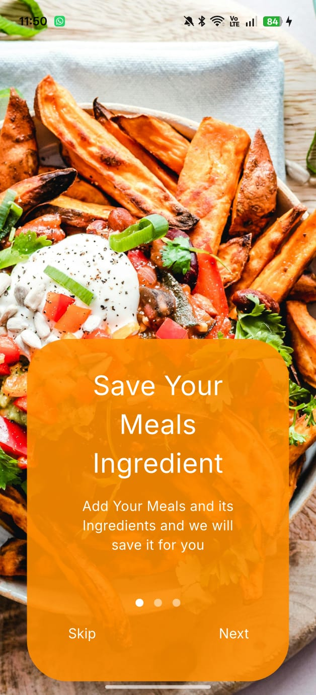
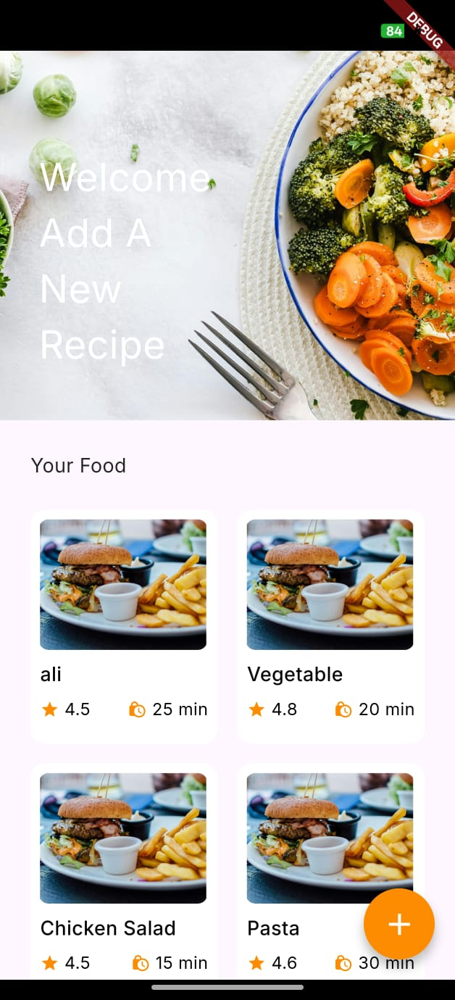
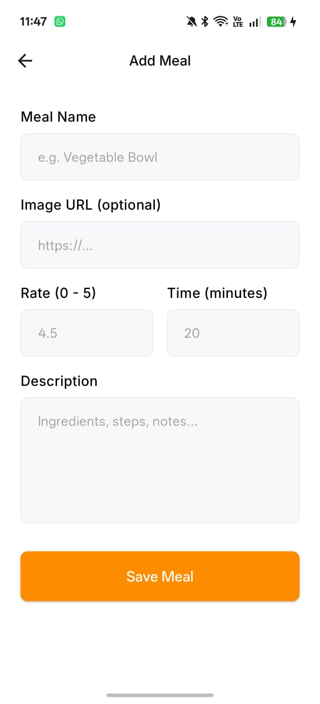
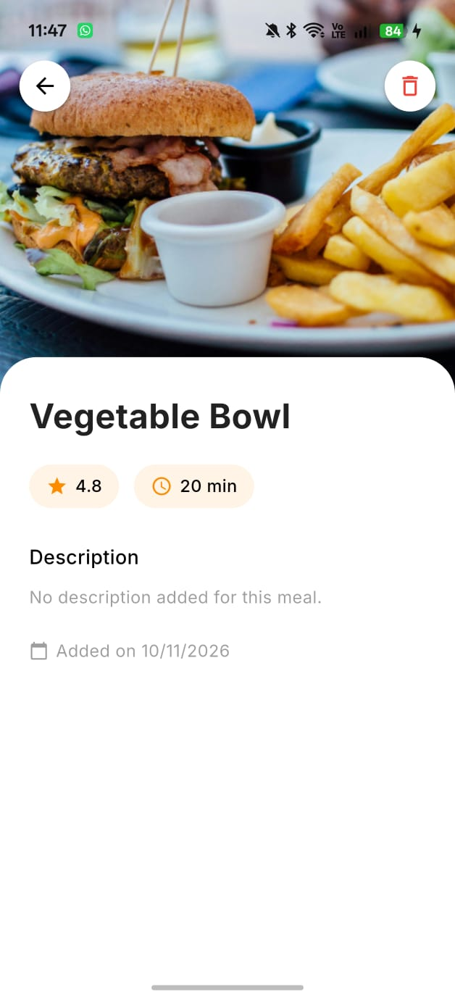

<h1 align="center">🍽️ Meals</h1>

<p align="center">
  A simple Flutter recipe app to save your favourite meals <b>offline</b>, with name, photo, rating, cooking time and description.
</p>

<p align="center">
  
  
  
  
</p>

---

## 📱 Screenshots

| Onboarding | Home | Add Meal | Meal Details |
|:---:|:---:|:---:|:---:|
|  |  |  |  |

---

## ✨ Features

- **Onboarding**: welcome screens shown only the first time the app opens (saved with `shared_preferences`).
- **Home**: grid of all your meals, updated live whenever a meal is added or deleted.
- **Add Meal**: form with validation for name, image link, rating (0–5), cooking time and description.
- **Meal Details**: full meal info (photo, name, rating, time, description, date added) with delete.
- **Offline storage**: everything is saved locally on the device with **Drift** (SQLite).
- **Responsive UI**: sizes scale across screen sizes using `flutter_screenutil`.

---

## 🛠️ Tech Stack

| Purpose | Package |
|---|---|
| Local database | [`drift`](https://pub.dev/packages/drift), [`drift_flutter`](https://pub.dev/packages/drift_flutter) |
| Navigation | [`go_router`](https://pub.dev/packages/go_router) |
| Responsive sizing | [`flutter_screenutil`](https://pub.dev/packages/flutter_screenutil) |
| Fonts | [`google_fonts`](https://pub.dev/packages/google_fonts) |
| Network images | [`cached_network_image`](https://pub.dev/packages/cached_network_image) |
| Onboarding carousel | [`carousel_slider`](https://pub.dev/packages/carousel_slider), [`dots_indicator`](https://pub.dev/packages/dots_indicator) |
| First-launch flag | [`shared_preferences`](https://pub.dev/packages/shared_preferences) |

---

## 📂 Project Structure

```
lib/
├── core/
│   ├── assets/        # Images and asset paths
│   ├── database/      # Drift database (Meals table + CRUD)
│   ├── routing/       # go_router routes
│   ├── styles/        # Colors, fonts, text styles
│   └── widgets/       # Shared widgets (button, text field)
├── features/
│   ├── onboarding/    # Onboarding screen + first-launch service
│   ├── home/          # Home grid + food item card
│   ├── add_meal/      # Add meal form
│   └── meal_details/  # Meal details screen
└── main.dart
```

---

## 🗄️ Database

Meals are stored in a single Drift table:

| Column | Type | Notes |
|---|---|---|
| `id` | int | Auto increment |
| `name` | text | 1–100 characters |
| `imageUrl` | text | Web link or local asset |
| `rate` | real | 0–5 |
| `time` | text | e.g. `20 min` |
| `description` | text | Optional |
| `createdAt` | datetime | Set automatically |

Four starter meals are added the first time the database is created.

---

## 🚀 Getting Started

```bash
# 1. Clone the repo
git clone https://github.com/Hagersamy/meals.git
cd meals

# 2. Install packages
flutter pub get

# 3. Generate the Drift database code
dart run build_runner build

# 4. Run the app
flutter run
```

> After changing the database table, run `dart run build_runner build` again.
